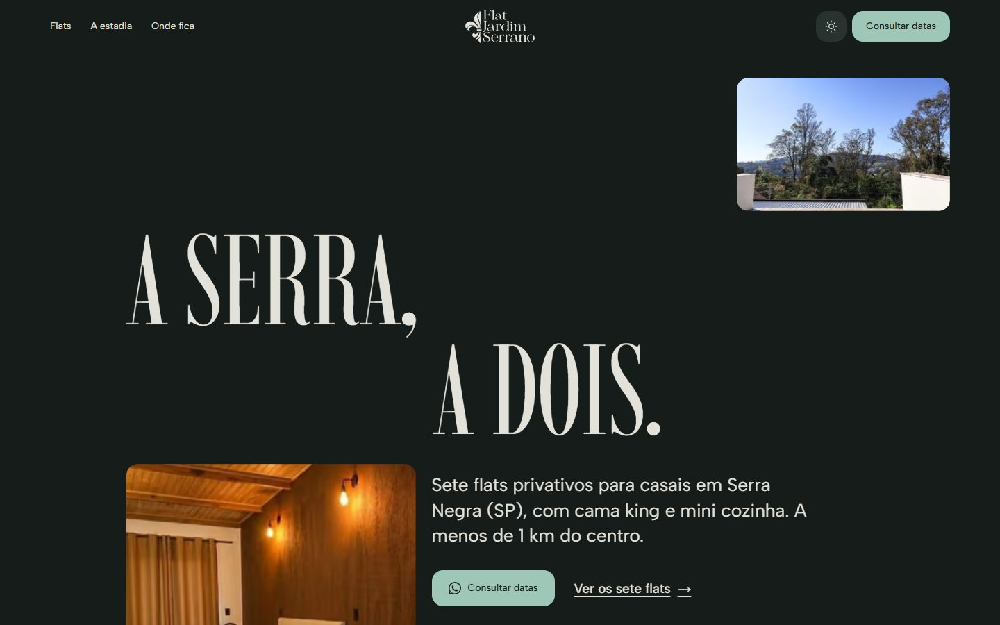
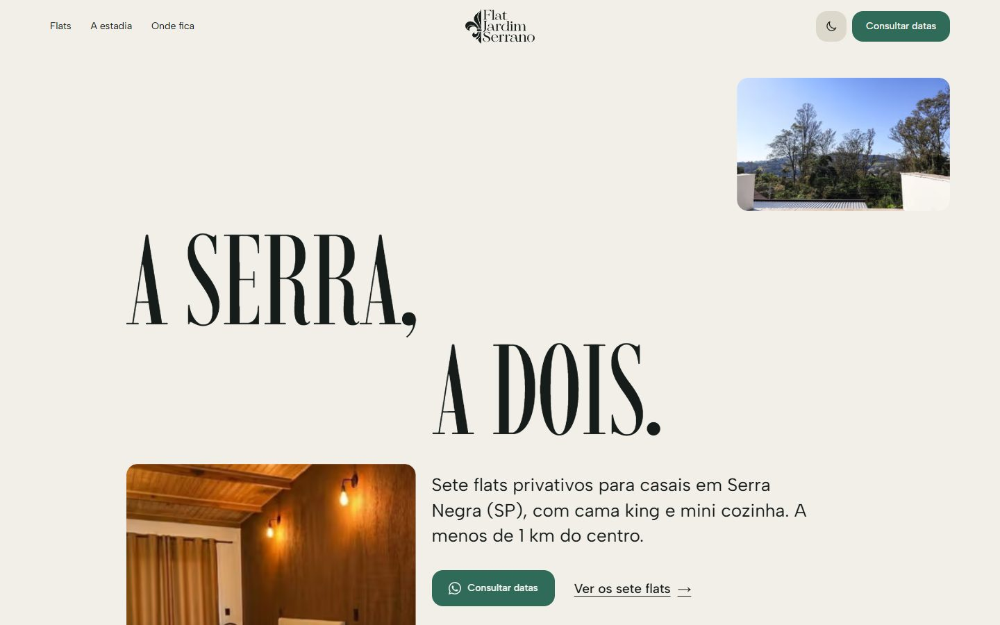
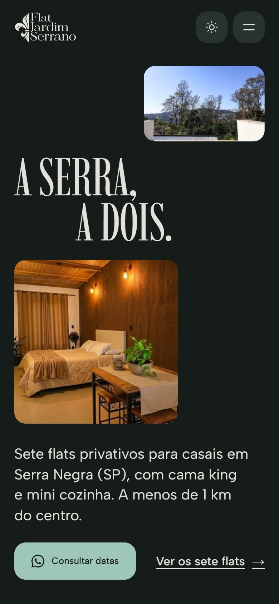
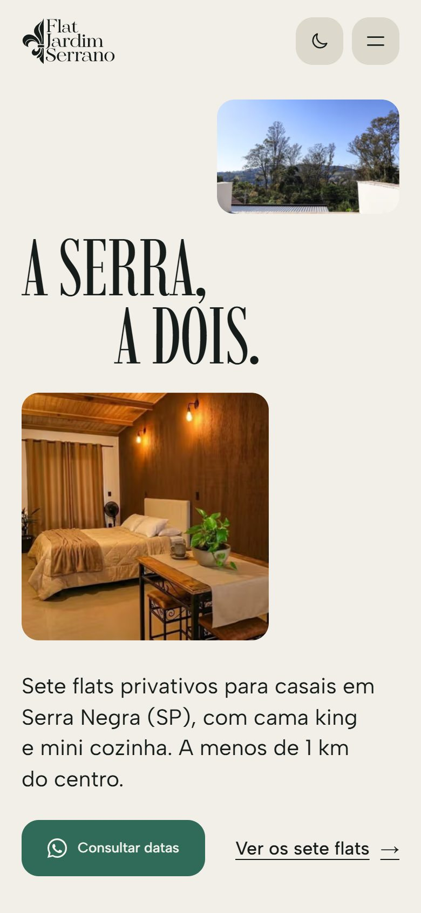
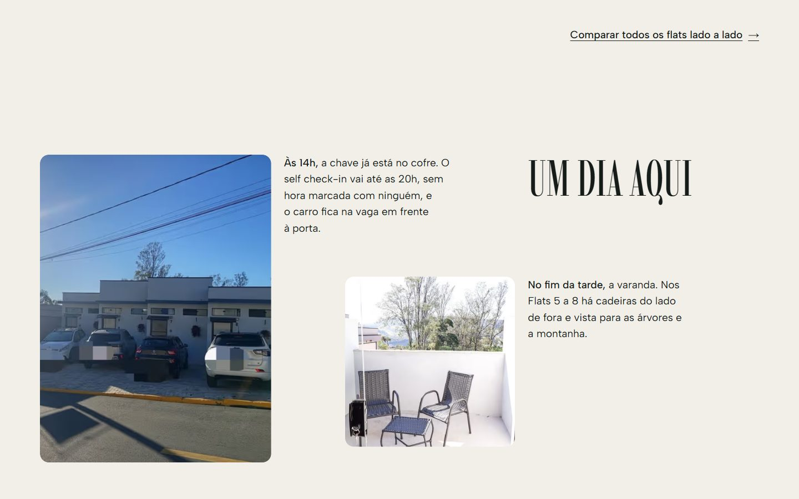
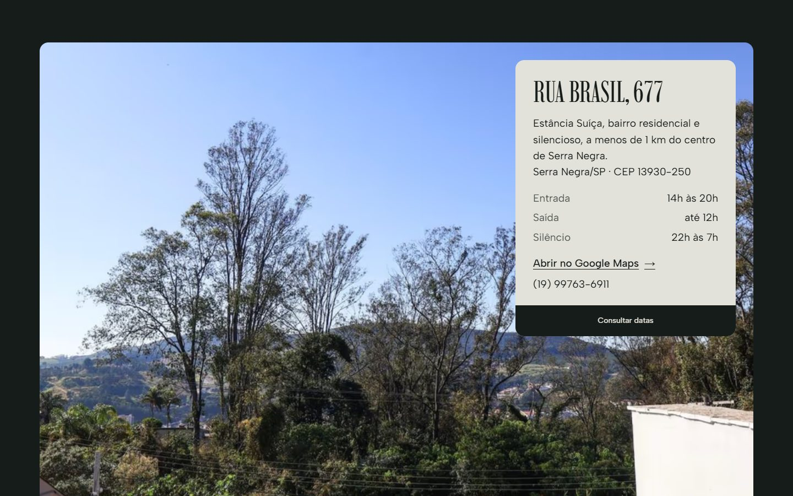
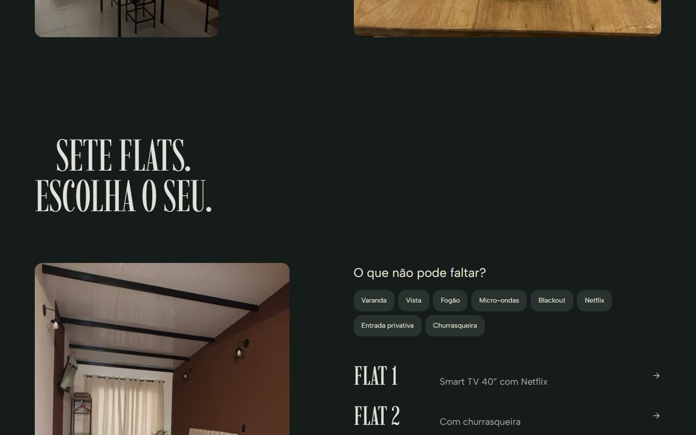
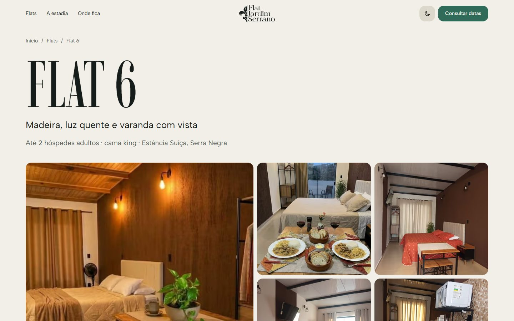
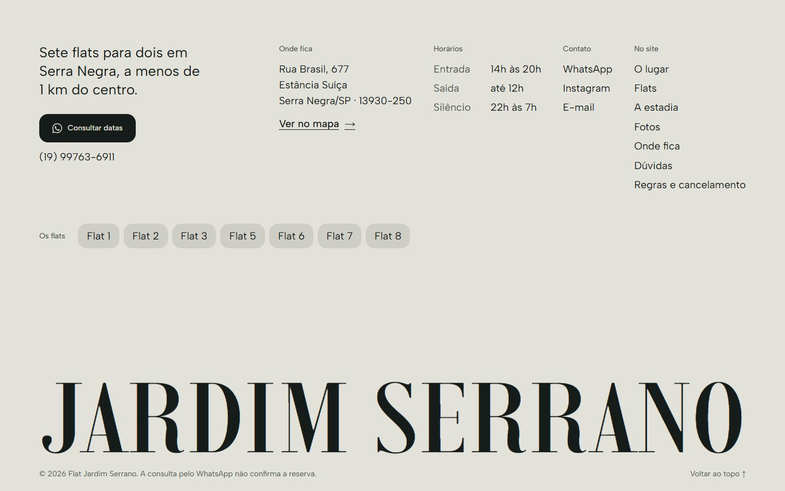

# Flat Jardim Serrano

Site de hospedagem para os sete flats do **Flat Jardim Serrano**, em Serra Negra (SP): flats privativos para casais, com reserva consultada pelo WhatsApp.



| Modo claro | Celular, nos dois temas |
|---|---|
|  |   |

## Destaques

- **Foco em conversão.** Uma ação em todo o site, *Consultar datas*. Ela abre um formulário de datas que calcula as noites e envia a mensagem pronta pelo WhatsApp. Sem JavaScript, o botão leva direto ao WhatsApp.
- **Seletor de flats.** O visitante marca o que não pode faltar (varanda, vista, fogão, Netflix, blackout…), vê quais flats têm tudo e consulta só esses.
- **Modo claro e escuro.** Segue a preferência do sistema, troca pelo botão do cabeçalho e lembra a escolha. Não pisca na troca porque o tema é aplicado antes da pintura.
- **Animações com propósito.** O título entra linha a linha, as fotos abrem como um obturador e cada seção chega em sequência. Os botões respondem ao toque. Tudo respeita `prefers-reduced-motion`.
- **Conteúdo real.** O site mostra fotos de cada unidade e as regras e condições publicadas pelo próprio estabelecimento. Não há avaliações, preços ou disponibilidade inventados.
- **Responsivo e acessível.** O layout próprio para celular tem barra de reserva fixa. Usa `<dialog>` nativo, foco visível, textos alternativos em todas as fotos e navegação por teclado.
- **SEO.** Metadados por página, Open Graph e JSON-LD (`LodgingBusiness`). As páginas dos flats são geradas estaticamente.

| A estadia, em fotos | Onde fica |
|---|---|
|  |  |
| **Seletor de flats** | **Página de um flat** |
|  |  |



## Tecnologia

- [Next.js 15](https://nextjs.org) (App Router) + React 19 + TypeScript
- CSS próprio, sem framework nem biblioteca de animação
- Fontes Imbue e Albert Sans via `next/font`
- Imagens otimizadas com `next/image` (AVIF/WebP)

## Rodar localmente

Requisitos: Node.js 18.18 ou mais recente (testado com o Node 24).

```bash
npm install
npm run dev
```

Abra http://localhost:3000.

Versão de produção:

```bash
npm run build
npm start
```

Verificação de tipos: `npm run typecheck`.

## Publicar

O jeito mais simples é a [Vercel](https://vercel.com/new). Importe o repositório do GitHub e confirme as opções padrão de Next.js. Não há variáveis de ambiente.

Antes de publicar, ajuste o domínio em `data/site-config.ts` (`url`) e veja a lista de [pendências](docs/pendencias.md).

## Páginas

| Rota | Conteúdo |
|---|---|
| `/` | Página inicial |
| `/acomodacoes` | Seletor, os sete flats em detalhe e a tabela comparativa |
| `/acomodacoes/flat-1` … `/acomodacoes/flat-8` | Galeria, comodidades, regras e formulário de cada flat |
| `/politicas` | Horários, convivência, pagamento e cancelamento |

## Estrutura

```
app/                  rotas (App Router) e layout com tema e metadados
components/
  layout/             cabeçalho, menu do celular, barra fixa, rodapé
  sections/           seções da página (Hero, FlatFinder, Experience, Gallery…)
  ui/                 botões, formulário e diálogo de reserva, lightbox, ícones, animações
data/                 conteúdo: flats, perguntas frequentes, contato e configurações
lib/                  links do WhatsApp e eventos de conversão
styles/globals.css    tokens (cores, tipos, tempos), estilos por seção e movimento
public/assets/        logo e fotos (flats/flat-N, areas-externas)
docs/                 decisões de design, arquitetura, inventário, pendências e capturas
```

## Onde editar

| O quê | Arquivo |
|---|---|
| WhatsApp, telefone, e-mail, endereço, horários, SEO | `data/site-config.ts` |
| Textos, comodidades e fotos de cada flat | `data/accommodations.ts` |
| Perguntas frequentes | `data/faq.ts` |
| Mensagens enviadas pelo WhatsApp | `lib/whatsapp.ts` |
| Cores dos dois temas, fontes, cantos (16 px) e tempos de animação | `styles/globals.css`, seção “Tokens” |
| Eventos de conversão (GA4 / Google Tag Manager) | `lib/track.ts` |
| Preço “a partir de” (desligado) | `data/site-config.ts` → `pricing` |

Para adicionar um flat, crie `public/assets/flats/flat-N/` e um novo item em `data/accommodations.ts`. Seletor, página, galeria, tabela, rodapé e formulário são atualizados automaticamente.

## Documentação

- [Decisões de design](docs/decisoes-design.md): direção de arte, paleta, tipografia, movimento e conversão
- [Arquitetura](docs/arquitetura-site.md): seções, fluxo de conversão e organização do código
- [Inventário de conteúdo](docs/inventario-conteudo.md): o que foi coletado no site original
- [Pendências](docs/pendencias.md): informações a confirmar antes de publicar

## Direitos

O código deste repositório pode ser reaproveitado. As fotografias, o logotipo e os textos pertencem ao Flat Jardim Serrano e não devem ser usados fora deste projeto sem autorização.
